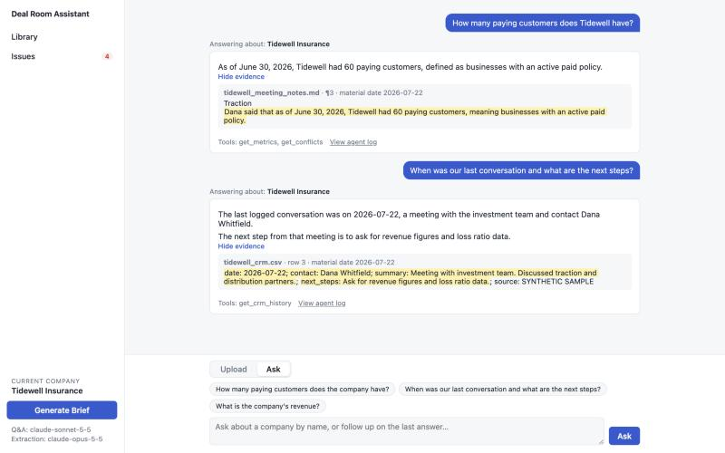
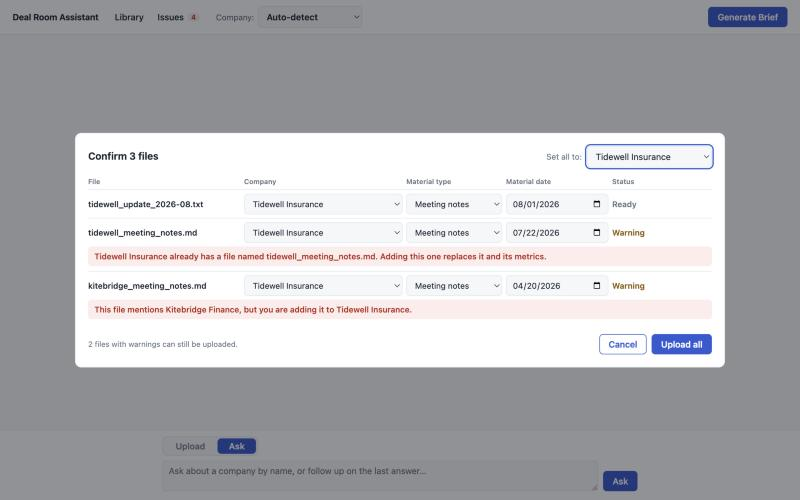

# Deal Room Assistant

**A research assistant for early-stage investment teams that answers questions about a company's files, with every claim linked to its exact source sentence.**



Upload a company's pitch deck, meeting notes and CRM log, ask questions, and generate a one-page
brief that flags **missing** and **conflicting** information instead of hiding it.

> Independent prototype, not affiliated with or commissioned by any firm. All sample data is synthetic
> and marked `SYNTHETIC SAMPLE`.

## What it does

1. **Import**: upload decks (text PDF, TXT, MD), meeting notes (TXT, MD, PDF) and CRM records (CSV).
   The system suggests the company, material type and date, and you confirm them. It warns if the
   file seems to belong to another company. Choosing several files opens a table with the same
   suggestions and checks on every row. Data survives restarts, and uploading a file with the
   same name replaces the old version, keeping its material date unless you give a new one.
2. **Organize**: files are split into chunks that keep their location (PDF page + paragraph,
   TXT/MD paragraph, CSV row) and are indexed for hybrid search. Key metrics are extracted into a
   table, each with a verbatim quote.
3. **Q&A**: ask a question that names a company, or follow up on the last one. An agent searches
   that company's materials with tools and answers in short claims; each claim can be expanded to show the file, location and quoted
   text. Claims that cite the same passage share one evidence panel, so it is shown only once.
4. **One-click brief**: "focus on traction and risks" → key metrics, recent communications,
   missing information and conflicts, each line with its source.
5. **Missing and conflicting information** is shown explicitly: "Not found in the provided
   materials", and conflicting values are listed side by side with their sources. The system never
   picks a winner. The **Issues** panel lists these per company and updates after every upload or delete.

The screen is one conversation, with an Upload / Ask switch above the input. The top bar has
**Library** (files and key metrics per company), **Issues**, an optional **Company** selector and
**Generate Brief**.

## Quick start

Requires Python 3.11+.

```bash
python3 -m venv .venv
.venv/bin/pip install -r requirements-dev.txt
cp .env.example .env            # then set ANTHROPIC_API_KEY in .env
.venv/bin/python scripts/load_samples.py      # optional: load the synthetic demo companies
.venv/bin/uvicorn app.main:app --port 8000
```

Open <http://localhost:8000>. The embedding model (`all-MiniLM-L6-v2`, about 90 MB) downloads
on first use and is cached by Hugging Face afterwards.

Tests:

```bash
.venv/bin/python -m pytest                 # offline: FakeLLM, no API calls (274 tests)
.venv/bin/python -m pytest -m live         # calls the real models (9 tests)
.venv/bin/python scripts/verify.py         # the 7 required checks end to end → docs/verification.md
```

## Configuration (`.env`)

| Variable | Default | Purpose |
|---|---|---|
| `ANTHROPIC_API_KEY` | – | Claude API key. Without a valid key, uploads still work, but metric extraction, Q&A and briefs report "Model call failed: API key invalid or missing. Check .env and restart the server." The server reads `.env` only at startup. |
| `LLM_PROVIDER` | `anthropic` | `anthropic` or `fake` (development only). |
| `LLM_EXTRACT_MODEL` | `claude-opus-5-5` | Model for metric extraction. |
| `LLM_CHAT_MODEL` | `claude-sonnet-5-5` | Model for Q&A and briefs. |
| `LLM_EFFORT` | `medium` | Reasoning effort (`low` … `max`). |
| `LLM_FALLBACKS` | `default` | Server-side fallback if a model declines a request; empty disables it. |
| `EMBEDDING_MODEL` | `sentence-transformers/all-MiniLM-L6-v2` | Local embedding model. Changing it re-embeds chunks automatically. |
| `DB_PATH` | `data/deal_room.db` | SQLite file (relative paths are relative to the project). |
| `AGENT_MAX_STEPS` | `6` | Max model calls per question or brief. |

All model access goes through `app/llm/` (`get_llm("extract" | "chat")`), so switching provider
or model is a configuration change plus, for a new provider, one adapter class.

## Supported formats

| Material | Formats | Location kept per chunk |
|---|---|---|
| Pitch deck | `.pdf` (text-based), `.txt`, `.md` | PDF: page + paragraph (`deck.pdf p.3 ¶2`); text: paragraph (`notes.md ¶3`) |
| Meeting notes | `.txt`, `.md`, `.pdf` | same as above |
| CRM records | `.csv` with columns `date, contact, summary, next_steps` (extra columns allowed; dates `YYYY-MM-DD`) | row (`crm.csv row 3`) |

Unsupported formats, scanned PDFs without a text layer, non-UTF-8 text, missing CRM columns and
invalid dates are rejected with a message that says what to fix.

## Architecture

```
            ┌──────────── UPLOAD ─────────────────────────────────────────────────────┐
 file ──▶ validate ──▶ parse + chunk (with location) ──▶ embed (local model) ──▶ SQLite
                                                             │
                                                             └─▶ extract metrics (Claude, 1 call/doc)
                                                                   └─▶ program checks quotes, normalizes
                                                                       numbers, fixes units/dates ──▶ SQLite

            ┌──────────── QUESTION / BRIEF ───────────────────────────────────────────┐
 question ──▶ agent loop (Claude tool use, ≤ 6 calls)
                 tools (company_id injected by the server, never chosen by the model):
                   search_documents  → hybrid search: WHERE company_id = ? → BM25 + vectors → RRF
                   get_metrics       → metrics table (value, as-of date, chunk_id, quote)
                   get_conflicts     → program-detected conflicts + unclear-basis metrics
                   get_crm_history   → CRM rows by date
              ──▶ final JSON: claims [{text, citations [{chunk_id, quote}]}], open items
              ──▶ program: keep only quotes found verbatim in a chunk of this company,
                  drop unsupported claims, attach conflicts touching cited chunks
              ──▶ UI: claims with expandable evidence, conflicts, open items
```

**Division of labour**: the *system stores* (files, chunks, vectors, metrics, logs); the
*agent looks things up* through tools and writes the answer; the *program judges* everything that
has a clear rule.

| Done by the model | Done by the program |
|---|---|
| Reading a document and proposing metrics (`value_raw`, quote, as-of date) | Checking every quote is verbatim in the cited chunk; dropping and logging failures |
| Choosing which tools to call and writing claims | Normalizing numbers (`$1.2M` → 1,200,000; `sixty` → 60) and units |
| Writing brief sections that follow the user's requirements | Conflicts (same company + metric + as-of date + unit, different values) |
| Simple one-step calculations in a brief, with the working shown and flagged | "(calculated)" mark, also added for a percentage or multiple not in the cited passage |
| Deciding whether a question is unrelated to company materials | The fixed reply to unrelated questions, with no open items |
| | Unclear basis (no as-of date), missing key metrics, company isolation |
| | Key-metrics table, recent communications, missing/conflict lists in the brief; a model section on communications is dropped |
| Open items in the brief, written as to-dos | One "Confirm which … is correct" to-do per conflict; model items on a missing or conflicting metric are dropped |

**Where data lives**: one SQLite file (`data/deal_room.db`):
`companies`, `documents`, `chunks` (text, location, float32 vector), `metrics`, `crm_records`,
`agent_logs` (every tool call, dropped citation and final answer; viewable at
`GET /api/runs/{run_id}/log`). Deleting or replacing a document removes its chunks, metrics and
CRM rows (cascade). The embedding model is cached in `~/.cache/huggingface`.

## How the company is chosen

The server decides, always. The model never chooses a `company_id`.

**Questions** (`POST /api/ask`), by name matching in the program:

| The question… | Result |
|---|---|
| names one company ("tidewel" also matches) | Answers about it and shows "Answering about: <company>" |
| names no company | Uses the company in the Company selector, which follows the last company used |
| names no company, and the selector is on Auto-detect | "Which company do you mean?" with company buttons |
| names several companies | Says it answers one company at a time and asks which |

The match uses the non-generic words of the name, so "Tidewell" matches Tidewell Insurance but
"insurance" alone matches nothing. A question naming another company still switches to it, and
the selector updates to show that.

**Uploads** (`POST /api/uploads/analyze`): the program checks the file name, then the content.
Only if neither names a known company does the model suggest a name, and that name counts only
if it literally appears in the file. Material type and date come from program rules. Nothing is
stored until you confirm. The confirmation warns, without blocking, if:

- the chosen company differs from the suggestion;
- the file mentions another existing company, or several companies;
- a file with that name would be replaced;
- a new company name resembles an existing one.

**Batch upload** (`POST /api/uploads/batch`): choosing several files opens one table instead of the
dialog, with the same suggestions and warnings on each row. One file still opens the dialog.



- **Set all to** puts every row on one company. A company selected at the top of the page is the default.
- A row whose company cannot be recognized must be given one before **Upload all** is enabled. The
  server also refuses the whole batch, storing nothing, if a row has no company.
- Files are stored first, so they can be asked about straight away. Metrics are then extracted in
  the background, one file at a time, and each row shows its progress.
- A failure stays on its own row with the reason. If only extraction failed, the file stays stored,
  and the *re-extract* link in Library can run it again.
- The Issues count updates as rows finish.

Progress is kept in memory. If the server restarts during a batch, the files stored so far stay
stored, but files still waiting are not processed.

## Why hybrid retrieval

Investment questions mix exact tokens and meaning. BM25 is good at exact terms (numbers,
dates, names: "410", "2026-06-30", "Kitebridge"), where embedding models are weak. Embeddings are
good at paraphrases ("last call" ↔ "Meeting with investment team"), where BM25 finds nothing.
The two rankings are merged with **Reciprocal Rank Fusion**: `score = Σ 1/(60 + rank)`. RRF uses
ranks only, so BM25 scores (unbounded) and cosine scores (−1…1) never need to be normalized
against each other. Example from the sample data: for "registered customers", the deck sentence
"100 small businesses have registered" is BM25 #2 but only vector #6; fused, it ranks #3.
Every search filters `WHERE company_id = ?` first, so another company's chunks are never candidates.

At this scale (hundreds of chunks per company), vectors live in SQLite and similarity is one
numpy matrix product; BM25 is rebuilt per query. Both are simple to explain and fast enough.

## API

| Method | Path | Purpose |
|---|---|---|
| GET / POST | `/api/companies` | List / create companies |
| GET / POST | `/api/companies/{id}/documents` | List / upload documents (multipart: `file`, `doc_type`, `doc_date`) |
| DELETE | `/api/documents/{id}` | Remove a document and everything derived from it |
| POST | `/api/documents/{id}/extract` | Re-run metric extraction |
| GET | `/api/documents/{id}/chunks` | Chunks with locations |
| GET | `/api/companies/{id}/search?q=…&k=6` | Debug view of hybrid search with both ranks |
| GET | `/api/companies/{id}/metrics` | Extracted metrics with sources |
| GET | `/api/companies/{id}/checks` | Conflicts, unclear basis, missing key metrics |
| POST | `/api/uploads/analyze` | Suggest company, type and date for a file; stores nothing |
| POST | `/api/uploads/warnings` | Consistency warnings for the company chosen in the confirmation |
| POST | `/api/uploads/batch` | Store several files in the background (multipart: `files`, plus `items` as JSON with `company_id` or `new_company`, `doc_type`, `doc_date`) |
| GET | `/api/uploads/batch/{id}` | Progress per file: `waiting`, `uploading`, `stored`, `analyzing`, `done`, `failed` |
| GET | `/api/issues` | All companies with their issue counts, computed live |
| POST | `/api/ask` | Q&A that works out the company (`{"question": …, "last_company_id": …}`) |
| POST | `/api/companies/{id}/ask` | Q&A for a company the user picked (`{"question": …}`) |
| POST | `/api/companies/{id}/brief` | Brief (`{"requirements": …}`), JSON + Markdown |
| GET | `/api/runs/{run_id}/log` | Agent log for one question or brief |

## Verification

The 7 required checks pass with the real models (`claude-opus-5-5` for extraction,
`claude-sonnet-5-5` for Q&A and briefs); see [docs/verification.md](docs/verification.md) for the
full run, including every answer and citation. The same behaviours are covered by deterministic
FakeLLM tests that run offline on every `pytest`.

What went wrong along the way, and how each problem was found and fixed: [docs/lessons_learned.md](docs/lessons_learned.md).

## Known limitations

- **Text PDFs only**: no OCR. Tables and multi-column layouts in PDFs lose their structure.
- **Paragraph detection is heuristic** (blank lines; short lines without punctuation are treated as
  headings).
- **One extraction call per document**: very long documents may need splitting.
- **Conflicts need an exact match** of metric, as-of date and unit. "Q2 2026" vs "June 30, 2026"
  are not recognized as the same basis, and units for `other` metrics come from the model.
- **Company matching only knows names.** It finds exact names and small typos of companies already in
  the system, not abbreviations or nicknames. A company whose name is a common word can match by accident.
- **Calculations are marked, not re-computed.** "(calculated)" tells the reader to check the working
  shown in the bullet; the program does not redo the arithmetic.
- **Date suggestions are heuristics.** A file name with only a month gives the 1st of that month, so
  check the date in the confirmation.
- **The number parser is English-only** ("sixty", "1.2M"); ranges such as "50–60" are not parsed.
- **Model output varies between runs.** Citations are always verified, but wording and which
  facts the model chooses to mention can differ.
- **Single user, no authentication**, local SQLite; chat history is not persisted; no streaming.
- **BM25 is rebuilt per query**, which is fine for one company's deal room but not for large corpora.

## Next steps

- Persist Q&A history and briefs per company, with a "what changed since the last brief" diff.
- Period-aware conflict matching (quarters, fiscal years) and an "accept / reject value" workflow
  so a human decision is recorded with its reason.
- More sources: email threads, data-room folders, spreadsheet KPIs (with cell-level locations).
- Evaluation set from real (anonymized) deal materials to tune extraction and retrieval.
- Streaming answers and per-claim confidence signals in the UI.

## Project layout

```
app/
  main.py         FastAPI routes
  config.py       settings from environment
  db.py           SQLite schema
  ingest.py       parsing + chunking with locations, upload/replace
  batch.py        batch upload: stores, then extracts metrics, in the background
  resolve.py      company name matching; which company a question is about
  intake.py       upload suggestions (company, type, date) and consistency warnings
  rag.py          embeddings, BM25 tokenizer, hybrid search with RRF
  extract.py      metric extraction + validation
  numbers.py      number normalization
  citations.py    verbatim quote check
  rules.py        conflicts, unclear basis, missing metrics
  agent.py        Q&A tool loop and citation verification
  brief.py        company brief (program parts + verified model sections)
  logs.py         agent_logs
  llm/            provider-neutral interface, Anthropic client, FakeLLM
static/           conversation UI (HTML, CSS, JS)
samples/          SYNTHETIC SAMPLE files + manifest.json
scripts/          make_samples.py, load_samples.py, verify.py
tests/            pytest suite (offline + `-m live`)
docs/             verification, decisions, lessons learned, demo script, screenshots
```
